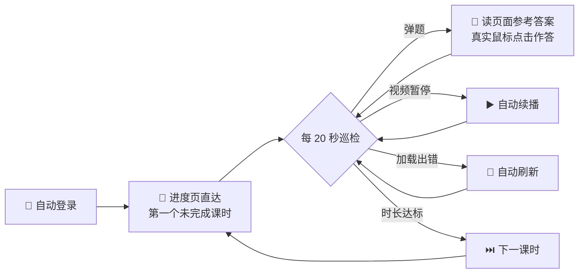

<div align="center">

# 🎬 Course Companion · 看课小帮手

**把「看视频课程」里最磨人的重复点击，交给一个懂事的浏览器。**

[](https://www.python.org/)
[](https://playwright.dev/python/)
[](https://www.microsoft.com/windows)
[](LICENSE)

*你负责把窗口放在前台，它负责剩下的一切。*

[中文](#-它能做什么) · [English](README_EN.md)

</div>

---

## 🎯 它能做什么

想象一下：一门 30 学时的在线课程，32 个视频，每个都要点播放、等弹题、答题、点下一节……**你只剩下一件事可做：把浏览器窗口留在屏幕上。**

| 🎁 能力 | ✨ 体验 |
|---------|---------|
| 🔐 **自动登录** | 账号密码自动填入；验证码图片自动弹出，你瞄一眼输 4 个数字，剩下交给它 |
| ▶️ **保持播放** | 视频暂停？自动续播。「加载出错」？自动刷新。进度在服务端，一秒不丢 |
| 💬 **课中应答** | 随堂问题弹出的瞬间，读取页面自带的参考答案并作答；解析不到就等你，绝不瞎选 |
| ⏭️ **课时推进** | 时长一到自动进入下一节；已完成的节「已读跳过」，绝不回头 |
| 🎯 **直达定位** | 不逐节翻找——从学习进度页一步跳到第一个未完成的课时 |
| 🔄 **会话续期** | Cookie 定期续存，挂一下午几乎不掉线；真掉线了自动重连 |

> 🛑 到达需要本人独立完成的**考核/测验**环节，它会自觉停下来——这部分请亲自上阵。

## 🚀 三步上手

```bash
# ① 安装依赖（国内镜像加速）
pip install playwright -i https://pypi.tuna.tsinghua.edu.cn/simple
python -m playwright install chromium

# ② 运行
python course_companion.py

# ③ 弹窗里填账号和密码（仅此一次），然后去干别的事
```

## ⚙️ 它是怎么工作的



- **真实浏览器事件**：Playwright 有头模式驱动 Chromium，每次点击都是完整的鼠标按下-释放序列，与真人无异
- **多级答案解析**：页面内嵌脚本的参考答案经过特殊字符处理，脚本用三级锚点策略稳定提取
- **会话持久化**：通过 `storage_state` 保存 Cookie，每个课时完成后自动续存

## 📁 文件说明

| 文件 | 用途 | 会进仓库吗 |
|------|:----:|:----------:|
| `course_companion.py` | 主程序 | ✅ |
| `credentials.local.json` | 你的账号密码（Base64 编码） | ⛔ `.gitignore` 排除 |
| `credentials.local.json.example` | 配置模板 | ✅ |
| `auth.json` | 登录会话（自动生成） | ⛔ `.gitignore` 排除 |

> 💡 **换电脑？** 拷走项目 → 删掉 `credentials.local.json` → 重新运行配置即可，30 秒搞定。
> 💡 **改密码？** 同上，删除配置文件重来。

## 📌 使用须知

1. 🖥️ **窗口保持前台**——可以缩小，别最小化。部分平台会暂停后台标签的计时（这是平台规则，不是 bug）
2. 🚫 **别多开**——同一账号多设备同时观看，平台只记录其一，两边都白挂
3. 🔢 **验证码**——只在掉线重连时出现，看图输数字约 10 秒；会话续期让它很少来打扰
4. 🧑‍💼 **考核请亲自**——需要你本人的部分，助手绝不代劳

## 📄 免责声明

本项目仅供**学习交流与个人效率提升**。使用前请阅读并遵守你所使用平台的服务条款；因使用本项目产生的一切账号风险由使用者自行承担。请勿将其用于商业代学等用途。

## 📜 License

[MIT](LICENSE) © 2026
