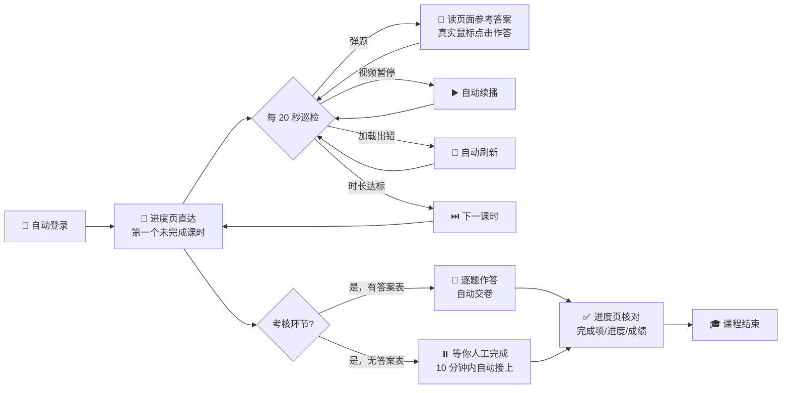

<div align="center">

# 🎬 Course Companion · 看课小帮手

**把「看视频课程」里最磨人的重复点击，交给一个懂事的浏览器。**

[](https://www.python.org/)
[](https://playwright.dev/python/)
[](https://www.microsoft.com/windows)
[](LICENSE)

*你负责把窗口放在前台，它负责剩下的一切。*

[中文](#-它能做什么) · [English](README_EN.md)

</div>

---

## 🎯 它能做什么

想象一下：一门 30 学时的在线课程，32 个视频，每个都要点播放、等弹题、答题、点下一节……**你只剩下一件事可做：把浏览器窗口留在屏幕上。**

| 🎁 能力 | ✨ 体验 |
|---------|---------|
| 🔐 **自动登录** | 账号密码自动填入；验证码图片自动弹出，你瞄一眼输 4 个数字，剩下交给它 |
| ▶️ **保持播放** | 视频暂停？自动续播。「加载出错」？自动刷新。进度在服务端，一秒不丢 |
| 💬 **课中应答** | 随堂问题弹出的瞬间，读取页面自带的参考答案并作答；解析不到就等你，绝不瞎选 |
| 📝 **考核自动交卷** | 课程最后的考核环节：提供 `answers.json` 答案表（题号→ChoiceX）自动逐题作答交卷；没有答案表就停下等你，10 分钟内人工完成它自动接上 |
| ✅ **交卷核对** | 交卷后自动到学习进度页核对完成项数、进度百分比、考核成绩与及格线 |
| ⏭️ **课时推进** | 时长一到自动进入下一节；已完成的节「已读跳过」，绝不回头 |
| 🎯 **直达定位** | 不逐节翻找——从学习进度页一步跳到第一个未完成的课时 |
| 🔄 **会话续期** | Cookie 定期续存，挂一下午几乎不掉线；真掉线了自动重连 |

## 📦 免安装版（推荐：下载即用）

不想配 Python 环境？直接下载/使用**单一可执行文件**，双击/一键运行，首次自动下载浏览器内核，弹窗填账号密码即可：

- **Windows**：`course_companion.exe` → 双击运行
- **macOS / Linux**：`course_companion` → `chmod +x` 后 `./course_companion`

> 各平台产物需在对应平台上用 `python build_exe.py` 构建（产物平台 = 构建机平台）。
> 内核（Chromium ~150MB）首跑联网下载一次，之后免下载；账号密码首跑弹窗录入并保存，之后免登录。

## 🛠️ 构建可执行文件（给分发者）

```bash
pip install pyinstaller playwright        # 构建机依赖
python build_exe.py                        # 生成 dist/course_companion[.exe]
```

- 产物为 PyInstaller **onefile** 模式（~50MB，不含浏览器内核）；
- `course_companion_gui.py` 是一键入口：先自检/下载 Chromium 内核，再调用主流程；
- 三平台分发：在三台构建机（Windows / macOS / Linux）上各跑一次 `python build_exe.py`，把三个产物分别放入 `releases/` 分发即可。

## 🚀 源码运行（需 Python）

```bash
# ① 安装依赖（国内镜像加速）
pip install playwright -i https://pypi.tuna.tsinghua.edu.cn/simple
python -m playwright install chromium

# ② 运行
python course_companion.py

# ③ 弹窗里填账号和密码（仅此一次），然后去干别的事
```

## ⚙️ 它是怎么工作的



- **真实浏览器事件**：Playwright 有头模式驱动 Chromium，每次点击都是完整的鼠标按下-释放序列，与真人无异
- **多级答案解析**：页面内嵌脚本的参考答案经过特殊字符处理，脚本用三级锚点策略稳定提取
- **会话持久化**：通过 `storage_state` 保存 Cookie，每个课时完成后自动续存
- **课程收尾**：交卷后自动核对学习进度页的完成项数、进度百分比与考核成绩，并对照及格线（进度 100% 且考核 ≥ 60 分）给出结论

## 📁 文件说明

| 文件 | 用途 | 会进仓库吗 |
|------|:----:|:----------:|
| `course_companion.py` | 主程序 | ✅ |
| `credentials.local.json` | 你的账号密码（Base64 编码） | ⛔ `.gitignore` 排除 |
| `credentials.local.json.example` | 配置模板 | ✅ |
| `auth.json` | 登录会话（自动生成） | ⛔ `.gitignore` 排除 |
| `answers.json` | 考核答案表（题号 → `ChoiceX` 列表；没有则考核环节等你人工） | 按需 |
| `questions.json` | 导出试卷用（脚本运行时可选生成，供整理答案参考） | 按需 |
| `progress_after.png` | 交卷后学习进度页截图（自动核对存档） | ⛔ 运行时生成 |
| `course_companion_gui.py` | 一键运行入口（自检内核 + 调主流程，供 PyInstaller 打包） | ✅ |
| `build_exe.py` | PyInstaller 构建脚本（生成各平台单文件可执行） | ✅ |

### 📝 考核答案表怎么填

考核环节需要逐题作答。把 30 题答案存成 `answers.json`，脚本到考核页时会自动读取、勾选并交卷；**缺题就停下等你，10 分钟内人工完成它自动接上**。

格式：`{题号: [ChoiceX, ...]}`，`ChoiceX` 中 X 是第 X+1 个选项（Choice0=A、Choice1=B、…）。单选 1 个值，多选多个值，判断题 Correct/Incorrect。

```json
{
  "1": ["Choice1"],
  "11": ["Choice0", "Choice1", "Choice2"],
  "21": ["Choice0"]
}
```

> 答案可以人工整理，也可以让 LLM 基于课程要点生成一份初稿再人工核对。脚本对缺失/错位的题只会提示，不会乱填。

> 💡 **换电脑？** 拷走项目 → 删掉 `credentials.local.json` → 重新运行配置即可，30 秒搞定。
> 💡 **改密码？** 同上，删除配置文件重来。

## 📌 使用须知

1. 🖥️ **窗口保持前台**——可以缩小，别最小化。部分平台会暂停后台标签的计时（这是平台规则，不是 bug）
2. 🚫 **别多开**——同一账号多设备同时观看，平台只记录其一，两边都白挂
3. 🔢 **验证码**——只在掉线重连时出现，看图输数字约 10 秒；会话续期让它很少来打扰

## 📄 免责声明

本项目仅供**学习交流与个人效率提升**。使用前请阅读并遵守你所使用平台的服务条款；因使用本项目产生的一切账号风险由使用者自行承担。请勿将其用于商业代学等用途。

## 📜 License

[MIT](LICENSE) © 2026
