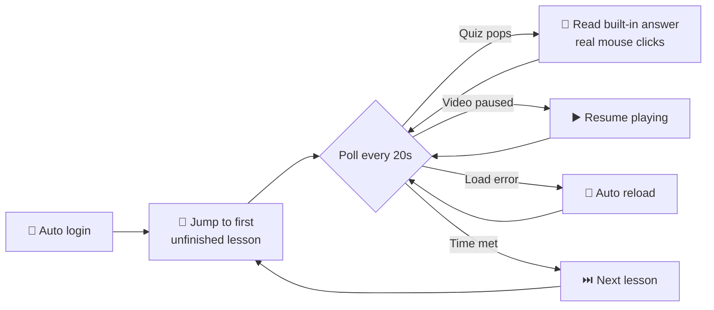

<div align="center">

# 🎬 Course Companion

**Hand the most tedious clicking of online video courses to a browser that actually behaves.**

[](https://www.python.org/)
[](https://playwright.dev/python/)
[](https://www.microsoft.com/windows)
[](LICENSE)

*You keep the window in the foreground. It handles everything else.*

[中文文档](README.md) · [English](#-features)

</div>

---

## 🎯 Features

A 30-credit online course means 32 videos of: press play, wait for the pop-up quiz, answer it, click next… **With this companion, the only thing left for you is keeping the browser window on screen.**

| 🎁 Capability | ✨ Experience |
|---------------|---------------|
| 🔐 **Auto login** | Credentials filled automatically; the CAPTCHA image pops up — just type 4 digits and it submits for you |
| ▶️ **Keep playing** | Paused? Auto-resumed. "Load error"? Auto-reloaded. Progress lives server-side, nothing lost |
| 💬 **In-video questions** | The moment a quiz pops up, the page's built-in reference answer is read and submitted; if parsing fails it waits for you — never guesses |
| ⏭️ **Lesson advancing** | Auto-jumps to the next lesson when time is met; completed lessons are skipped instantly |
| 🎯 **Jump to first unfinished** | No clicking through lessons — lands directly on the first unfinished one via the progress page |
| 🔄 **Session renewal** | Cookies refreshed periodically; long runs almost never expire — and if they do, auto re-login kicks in |

## 🚀 Quick start

```bash
# ① Install dependencies
pip install playwright
python -m playwright install chromium

# ② Run
python course_companion.py

# ③ Fill in account & password in the dialogs (one-time only), then go do something else
```

## ⚙️ How it works



- **Trusted browser events** — Playwright drives Chromium in headed mode; every click is a full mouse press-release sequence, indistinguishable from a human
- **Multi-strategy answer parsing** — the page's embedded script obfuscates some characters; three anchor strategies extract answers reliably
- **Session persistence** — cookies saved via Playwright `storage_state`, renewed after every completed lesson

## 📁 Files

| File | Purpose | Committed |
|------|:----:|:----------:|
| `course_companion.py` | Main program | ✅ |
| `credentials.local.json` | Your account & password (Base64) | ⛔ excluded via `.gitignore` |
| `credentials.local.json.example` | Template | ✅ |
| `auth.json` | Login session (auto-generated) | ⛔ excluded via `.gitignore` |

> 💡 **New computer?** Copy the project → delete `credentials.local.json` → run and reconfigure. 30 seconds.
> 💡 **Changed password?** Same — delete the config file and run again.

## 📌 Notes

1. 🖥️ **Keep the window foreground** — resizing is fine, minimizing is not. Some platforms pause timers on background tabs
2. 🚫 **No multiple instances** — most platforms count only one watch session per account
3. 🔢 **CAPTCHA** — only appears after a session expires (~10 seconds of typing); session renewal keeps it rare

## 📄 Disclaimer

This project is for **learning and personal productivity** only. Read and follow the terms of service of the platform you use; you are responsible for your own account. Do not use it for commercial proxy-learning services.

## 📜 License

[MIT](LICENSE) © 2026
